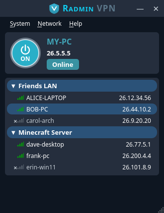

# Radmin VPN on Linux (unofficial)

Radmin VPN only exists for Windows. This project runs the **real** Radmin VPN
inside a tiny headless Windows VM and gives you a native Linux window and tray
icon for it. Your Linux games and apps reach the Radmin network (26.x.x.x)
directly; you never have to look at Windows.

## Install

One command, as your normal user (it asks for your password once, for the
system packages):

    curl -fsSL https://raw.githubusercontent.com/gabrielmf1998/Radmin-Linux-KDE/main/bootstrap.sh | bash

Then open **Radmin VPN** from the app menu (or run `radmin-linux`), click the
power button and use **Network > Join a network**.

* Works on Arch/Manjaro, Debian/Ubuntu/Mint, Fedora and openSUSE.
* Needs a CPU with virtualization enabled in the BIOS (VT-x / AMD-V), about
  **12 GB free disk** during the install (9 GB after) and NetworkManager.
* The download (about 3 GB) shows a progress bar, is checked against the release
  checksums and **resumes** if it stops: just run the same command again.
  Nothing big goes to `/tmp`.
* Running the command again later **upgrades** the app and keeps your VM and
  your Radmin identity.

Options go on the bash side of the pipe, e.g. `curl ... | RADMIN_MIRROR=gitlab bash`:

| option | what it does |
|---|---|
| `RADMIN_MIRROR=gitlab` | download from the [GitLab mirror](https://gitlab.com/gabriel17166/radmin-linux) |
| `RADMIN_VERSION=0.3.0` | a specific release instead of the latest |
| `RADMIN_NEW_IMAGE=1` | download a fresh VM image even if one is installed |
| `RADMIN_VM_IMAGE=/path/file.qcow2.zst` | use an image you already have |

Uninstall: `~/.local/share/radmin-linux/uninstall.sh` (add `--keep-image` to keep the VM).

## Your own Radmin identity

Radmin keeps the node identity (node id, 26.x address, network list) inside
Windows. The VM image of **0.1.0 shipped with the builder's identity**, so
everyone who downloaded it appeared as the same node and saw the same networks.

Since 0.3.0 every install gets its own identity automatically:

* the release image starts with no identity at all;
* each install has its own id (`RADMIN_VM_UUID` in `~/.config/radmin-linux/config.env`);
  when the VM sees a different id (a copied or older image) it resets Radmin to
  a brand new node and the app tells you once;
* **System > Reset Radmin identity** does it by hand at any time.

If you installed 0.1.0: after upgrading, the first boot gives you a new node, so
join your networks again. If you run a Radmin network that someone joined with
a 0.1.0 install, that member may be the shared identity: remove it and change
the network password.

## What is fixed in 0.3.0

See [CHANGELOG.md](CHANGELOG.md). In short: no more shared identity and
networks, the window answers instantly (agent API instead of a 10 to 20 s WMI
login per refresh), the VM idles at about 2% of one core, a clean VNC picture,
a firewall inside the VM, and a curl installer that resumes and verifies.

## How it works

    Linux app ──HTTP (API) / WMI──▶ Windows VM (1 GB, 1 CPU, headless) ──▶ real Radmin VPN
        │                              │  ICS shares the Radmin adapter
        └── route 26.0.0.0/8 ─── tap ──┘  with the Linux link (NAT)

* **tapradmin** (192.168.137.2) is a private link between Linux and the VM
  (192.168.137.1). Linux routes 26.0.0.0/8 through it; Windows Internet
  Connection Sharing NATs that traffic into the Radmin network.
* **The agent** (`agent/`, runs in the VM as scheduled tasks): gives the install
  its own identity, hardens Windows, keeps ICS applied, never sleeps, self
  repairs every 15 min and serves a small JSON API on the private link only.
* **The app** (`app/`, PySide6): node, status and peers (online from ARP and
  ping, offline from a local roster, full member list from the Radmin window),
  connect/disconnect, rename, leave, Radmin updates, tray icon, watchdog.
* **Join / create a network** needs the real Radmin window (it does the
  handshake with the Radmin servers): the app brings it to the front and opens
  it in a VNC viewer.

### Security

* The VM firewall blocks everything coming in except from the Linux link and
  pings. Radmin peers cannot reach Windows services.
* On Linux, the link is in the firewalld zone **block**: the VM cannot open
  connections to your PC (replies to your own connections still pass).
* The VM account is `bench:bench`. It is only reachable from your own PC.

## Limits

* Hosting a server **on Linux** for your Radmin friends is not supported yet:
  the VM NATs Linux, so peers can reach the VM's 26.x address but not your PC.
  Joining servers hosted by others works.
* The image ships Radmin VPN 2.0.4899.9. Radmin 2.1 needs the Windows 7 SHA-2
  update; **System > Check for Radmin update** reports that instead of failing
  silently.
* Starting the VM takes about 10 to 60 s.

## Troubleshooting

| what | where |
|---|---|
| check and repair everything | `~/.local/share/radmin-linux/preflight.sh` |
| install log | `~/.local/share/radmin-linux/install.log` |
| VM console (the Windows screen) | Network > Open the Radmin window |
| VM diagnostics with repair | System > Full diagnostics |
| agent logs (in the VM) | `C:\radmin-agent\*.log` |
| reinstall the VM agent | System > Reinstall the VM agent, or `deploy-agent.sh --force` |

Settings live in `~/.config/radmin-linux/config.env` (environment variables win).
Useful ones: `RADMIN_VM_RAM` (MB, default 1024), `RADMIN_VM_SMP` (default 1),
`RADMIN_NET=passt` (alternative VM network, uses more CPU on QEMU 11).

## Building the VM image (maintainers)

    ./build-vm.sh --clean SRC.qcow2      # release image from a working VM (SRC untouched)
    ./build-vm.sh --from-scratch WIN.iso # Windows + Radmin from zero

`--clean` boots a throwaway copy **offline**, installs the current agent, runs
`provision/release-clean.ps1` (no identity, no networks, no browser, logs and
caches gone, neutral computer name, free space zeroed) and writes the split
`.zst` parts plus `SHA256SUMS`.

## Repository

    agent/       scripts that run inside the VM (identity, harden, api, boot, health, update…)
    app/         the Linux app (PySide6)
    shim/        old WMI state script, fallback for VMs without the API
    provision/   unattended Windows setup and the release cleaner
    vm/          run / stop / view the VM
    bootstrap.sh install.sh uninstall.sh preflight.sh radmin-linux.sh deploy-agent.sh build-vm.sh

Not affiliated with Famatech. Radmin VPN is their product and is downloaded
from their site.
